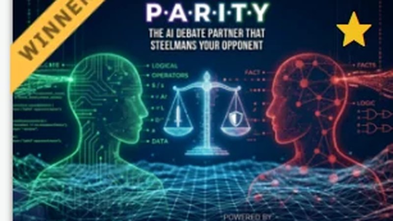
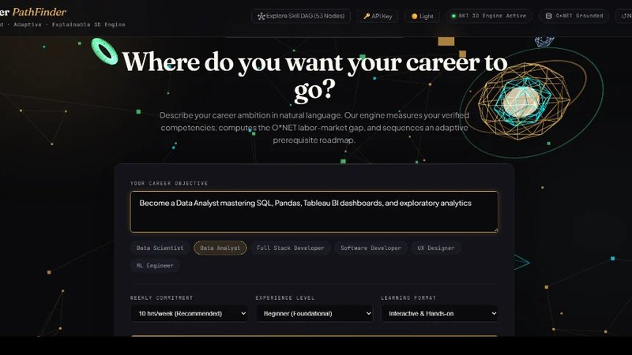
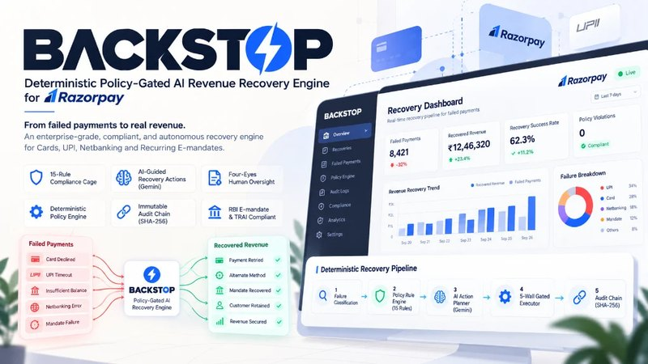
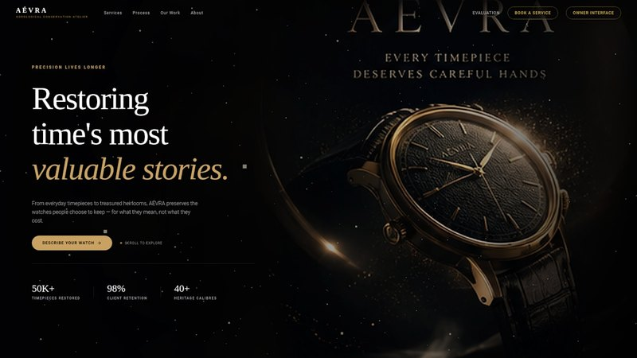
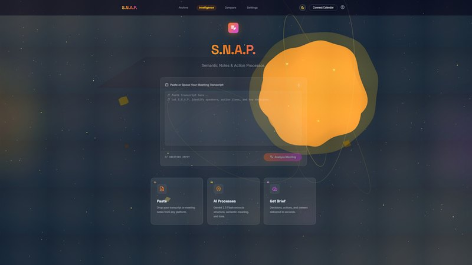
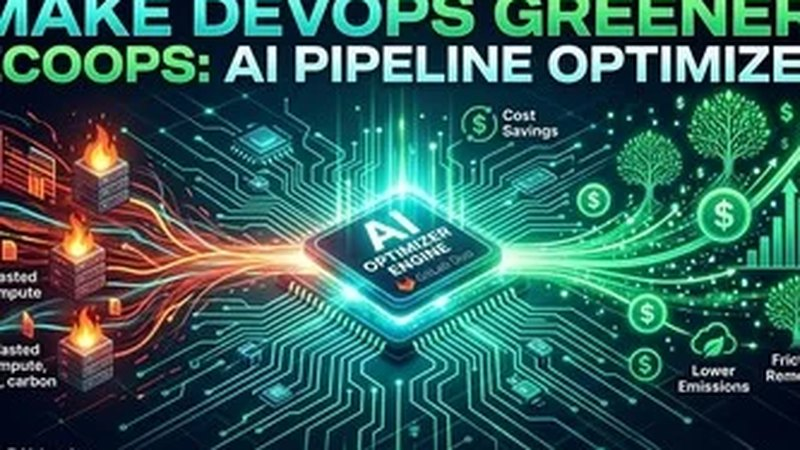

<a href="https://portfolio-mayankk1720.vercel.app/">
  <picture>
    <source media="(prefers-color-scheme: light)" srcset="assets/header-light.svg">
    
  </picture>
</a>

  

  
  

I turn ideas into working products, fast. Give me a problem and a deadline and you get a deployed app, clean source code and an interface people remember. Most of what's below was designed, built and shipped in a single hackathon weekend.

<table align="center">
<tr>
<td align="center" width="25%"><h3>🏆 Winner</h3>LovHack Season 2 with PARITY</td>
<td align="center" width="25%"><h3>#6 National</h3>Finalist, AMPlified S1 with Career PathFinder</td>
<td align="center" width="25%"><h3>14+ shipped</h3>AI products, games and 3D sites</td>
<td align="center" width="25%"><h3>CI-tested</h3>Flagship repos build green on every push</td>
</tr>
</table>

## About me

- 🎓 Final-year B.Tech CSE at **BBDU Lucknow** (graduating May 2027)
- 🏆 **Winner, LovHack Season 2** with [PARITY](https://parity-rosy.vercel.app), a 5-round AI voice debate arena
- 🥈 **Rank #6 national finalist, AMPlified Season 1** with [Career PathFinder](https://github.com/nika619/Career-pathfinder-nika619)
- 🔭 Building AI products, Rive/SVG motion and 3D web experiences, and taking freelance work on [Contra](https://contra.com/mayank_tiwari_a4vkcjsh)
- 💬 Ask me about LLM features you can trust in production, scroll-driven 3D sites, or Rive state machines

## What I can build for you

| | | |
|---|---|---|
| **AI web apps & MVPs** Tools that do real work with LLMs: intake forms, dashboards, copilots, internal tools. React, TypeScript, Python, FastAPI. [Start a project →](https://contra.com/s/eg6e7bXR-ai-powered-web-app-or-mvp-designed-and-shipped) | **Cinematic 3D websites** Scroll-driven landing pages with Three.js, GSAP and Lenis that still load fast and work on phones. [Start a project →](https://contra.com/s/FFe2WvmO-cinematic-3-d-scroll-website-or-landing-page-threejs) | **Rive & SVG motion** Interactive UI, game HUDs, animated ads and editable templates that weigh kilobytes, not megabytes. [Start a project →](https://contra.com/s/B7YOBeFL-rive-or-svg-animation-for-your-app-site-or-ad) |

## Featured work

<table>
<tr>
<td width="50%" valign="top">

<a href="https://parity-rosy.vercel.app"><b>PARITY</b></a> 🏆 Winner, LovHack Season 2

Enter any opinion, pick a side, and argue it out with an AI across 5 voiced rounds before a judge rules. It steelmans the side you oppose.

<code>Gemini Flash</code> <code>Web Speech API</code> <code>WebSockets</code>

</td>
<td width="50%" valign="top">

<a href="https://github.com/nika619/Career-pathfinder-nika619"><b>Career PathFinder</b></a> · <a href="https://career-pathfinder-nika619.onrender.com/">Live ↗</a> 🥈 Rank #6 national finalist, AMPlified Season 1

Explainable AI engine that turns a career goal into an adaptive, prerequisite-ordered learning path and shows why each step is there.

<code>FastAPI</code> <code>scikit-learn</code> <code>Gemini</code> <code>CI</code>

</td>
</tr>
<tr>
<td width="50%" valign="top">

<a href="https://github.com/nika619/BackStop-"><b>BackStop</b></a> Razorpay AI Buildathon

Recovers failed Razorpay payments with AI, but every action passes a deterministic policy gate and lands in a SHA-256 hash-chained audit log.

<code>FastAPI</code> <code>React 19</code> <code>pytest</code> <code>Razorpay</code>

</td>
<td width="50%" valign="top">

<a href="https://github.com/nika619/aevra-atelier"><b>AÉVRA</b></a> · <a href="https://atelier-time-sync.lovable.app">Live ↗</a> Lovable AI Hackathon

Cinematic site for a luxury watch-restoration atelier. A smart intake turns "can I book?" into "you're booked", with an owner dashboard behind it.

<code>React</code> <code>GSAP</code> <code>React Three Fiber</code> <code>Lenis</code>

</td>
</tr>
<tr>
<td width="50%" valign="top">

<a href="https://github.com/nika619/snap-app"><b>S.N.A.P.</b></a> · <a href="https://snap-app-491619.uc.r.appspot.com">Live ↗</a>

Paste a messy meeting transcript and get decisions, owners and action items in seconds.

<code>React</code> <code>Three.js</code> <code>Gemini 2.5 Flash</code> <code>Google Cloud</code>

</td>
<td width="50%" valign="top">

<a href="https://github.com/nika619/ecoops"><b>ECO-OPS</b></a> GitLab AI Hackathon

Cuts wasted CI/CD compute by skipping pipeline jobs that add nothing for a given commit, and reports the CO₂ it avoided.

<code>Python</code> <code>GitLab CI</code> <code>Gemini</code> <code>pytest</code>

</td>
</tr>
</table>

## More builds

<b>11 more projects</b>: games, security tools, local AI agents, motion templates

| Project | What it is | Stack |
|---|---|---|
| [Evident](https://github.com/nika619/Evident--the-ultimate-help-) | Career intelligence grounded in your actual code: turns what you built into resume claims you can prove (RevenueCat Shipathon 2026) | React Native, TypeScript, Zustand, RevenueCat |
| [SepsisGuard AI](https://github.com/nika619/SepsisGuard-AI-Real-Time-Sepsis-Intelligence-MCP) | MCP server giving AI assistants real-time sepsis risk intelligence from vitals, labs and nursing notes | Python, Model Context Protocol |
| [PRAGMA](https://github.com/nika619/PRAGMA) | Cyber threat intelligence console with a live 3D globe, AI analysis of IPs, URLs and hashes, and MITRE ATT&CK mapping | Next.js, React Three Fiber, D3, Gemini |
| [The Silent Protocol](https://github.com/nika619/The-Silent-Protocol.) | Systemic narrative game: you are the city's optimisation AI, and every policy has a human cost | Three.js, GSAP, Vite |
| [VIGIL](https://github.com/nika619/VIGIL-Verify-Impairment.-Guard-Innocent-Lives.) | Pre-drive wellness check that briefs the driver before they get behind the wheel (UN SDG 3.6) | JavaScript, Express, Gemini 2.5 Flash |
| [F.O.R.G.E.](https://github.com/nika619/FORGE.) | Gamified productivity engine that turns goals into quests, XP and levels | React, TypeScript, Framer Motion, Zustand |
| [Market Day](https://github.com/nika619/conjure-svgator) | 15-second animated ad template: swap 5 lines of text, 2 images and 1 colour | SVGator, SVG |
| [NIDS](https://github.com/nika619/nids-project) | Network intrusion detection with live packet capture and a real-time dashboard | scikit-learn, SMOTE, Flask, Scapy |
| [ELITE Agent](https://github.com/nika619/elite-agent) | Fully local autonomous agent with a plugin system, CLI and web UI | Python, Ollama, DeepSeek-R1 |
| [EMBERWICK](https://emberwick1.netlify.app/street.html) ↗ | Browser ghost story where a Rive HUD is driven live by the game state | Three.js, Rive, WGSL |
| [MOSAIC](https://mosaic-708.created.app/) ↗ | Five inputs in, a full brand identity kit out in 90 seconds | AI workflow |

## Stack

   
  

Motion and 3D: **GSAP · ScrollTrigger · Lenis · React Three Fiber · Rive · SVGator · WGSL shaders** 
AI: **Gemini · Claude · MCP servers · Ollama · scikit-learn**

## How I work

- **Ship first, then polish.** You see a working build early, not a slide deck.
- **Grounded AI.** I design features so the model's output can be checked, logged and explained.
- **Motion with a job.** Animation has to guide attention or explain something, or it doesn't go in.
- **Green builds.** My main projects build and test in GitHub Actions on every push.
- **Clean handover.** Deployed app, readable source, a README like the ones above, and a short walkthrough.

## Let's build something

Have an idea, a deadline, or a product that needs to feel alive? **[Message me on Contra](https://contra.com/mayank_tiwari_a4vkcjsh)** and I'll reply with a plan and timeline.

Lucknow, India · working with teams worldwide

